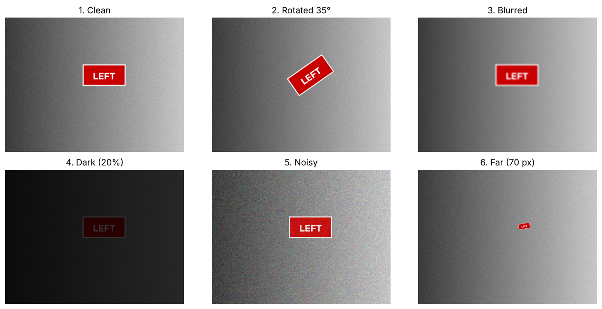
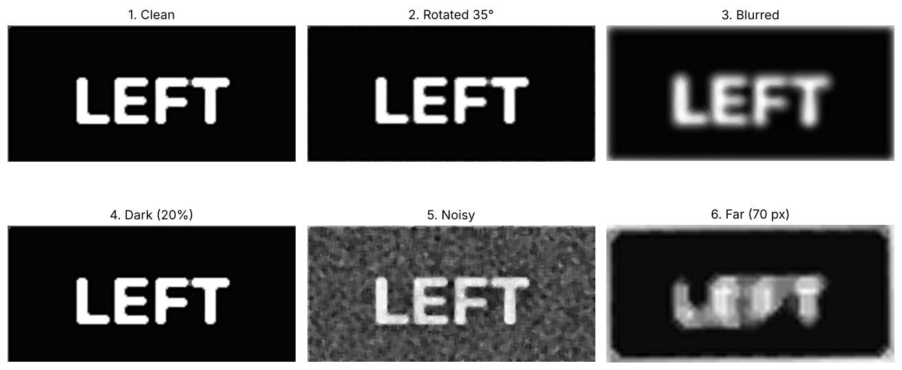
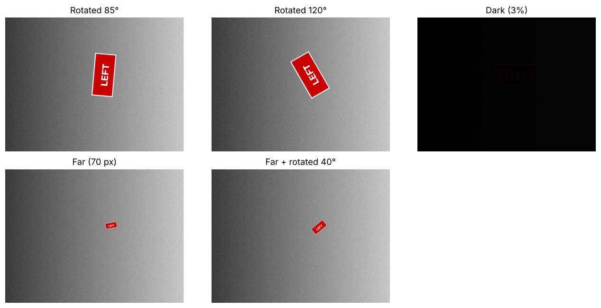

# Robust Sign Reading for a Mobile Robot

A perception module that lets a robot **detect sign boards, read them, and turn the text into a motion command** (STOP / LEFT / RIGHT / GO), designed to keep working under the conditions a moving robot camera actually produces: rotation, distance, motion blur, low light and sensor noise.

The project starts from a simple baseline, measures exactly where it fails, and then fixes each failure with a specific technique.

**Stack:** Python · OpenCV · YOLOv8 (Ultralytics) · EasyOCR · Google Colab (T4 GPU)

---

## Pipeline

```
camera frame
   │
   ├──► YOLOv8n ─────────────► general objects (person, chair, stop sign, ...)
   │
   └──► red-board ROI (HSV mask + shape filter)
            │
            ├──► deskew (minimum-area rectangle)
            ├──► enhance (contrast stretch, CLAHE, median denoise, upscale, unsharp mask)
            ├──► OCR (EasyOCR, upper-case allow-list, upright + 180°)
            │
            └──► multi-strategy selection  ──► fuzzy command match ──► robot action
                 (board ± enhance, full frame ± enhance)                 (difflib)
```

## Results

### 1. Stress tests: full-frame OCR vs. the pipeline



| Condition | Full-frame OCR (baseline) | Pipeline |
|---|---|---|
| Clean | LEFT · 0.98 | LEFT · 1.00 |
| Rotated 35° | LEFT · 0.94 | LEFT · 1.00 |
| Motion blur | LefT · 0.72 | **LEFT · 0.90** |
| Dark (20% light) | LeFT · 0.62 | **LEFT · 1.00** |
| Sensor noise | LEFT · 1.00 | LEFT · 1.00 |
| Far (70 px board) | Left · 0.86 | **failed** |

The pipeline clearly helps on blurred and dark frames. On the 70-pixel board it **fails**: upscaling and sharpening destroy the few pixels that carry the letters. Preprocessing is not free; it can hurt.



### 2. Hard cases: single-path pipeline vs. multi-strategy reader



| Condition | `robot_see` | `robot_see_v2` | Winning strategy |
|---|---|---|---|
| Rotated 85° | LJJ → no command | **LEFT** | board, no enhance |
| Rotated 120° | LJJ → no command | **LEFT** | board + enhance (180°) |
| Dark (3% light) | no board found | **LEFT** | full frame + enhance |
| Far (70 px) | no board found | **LEFT** | full frame |
| Far + rotated 40° | I → no command | **LEFT** | board, no enhance |

**5 of 5 failure cases recovered.** Beyond 60° rotation the deskew step flips the board upside down; reading both upright and rotated by 180° fixes this.

### 3. Realistic photos

On six realistic test photos, `robot_see_v2` passed **5 of 6** scenes:

| Scene | Result | Why |
|---|---|---|
| STOP, front view | pass | All strategies agreed; YOLO also detected "stop sign" (two independent cues) |
| LEFT, viewed at ~45° | **fail** | Perspective makes the board a trapezoid; rotation-only deskew cannot correct it |
| RIGHT, far away | pass | Board below `min_area`; recovered by full-frame fallback |
| GO, low light + blur | pass | Enhancement + allow-list read GO; without them OCR read "09" |
| STOP on a red brick wall | pass | Colour mask picked a brick patch; recovered by full-frame fallback |
| Empty corridor, red fire extinguisher | pass | No false command |

### 4. Speed–accuracy trade-off

The multi-strategy reader takes about **0.5–0.7 s per frame on a Colab T4 GPU** (the executed notebooks in this repo were run on a 2-core CPU, about 15 s per frame). That is far slower than a 30 fps camera, so on a robot it should be gated: run OCR only when a board-like region is detected or every N-th frame, and stop as soon as one strategy returns a confident, valid command.

## Limitations and next steps

- **Perspective distortion** — add 4-corner detection and `cv2.getPerspectiveTransform`, as in document-scanner apps.
- **Colour-only localisation is a weak cue** — red backgrounds produce false candidates; check for text inside candidates or train a small sign detector.
- **`min_area` trade-off** — lower values find distant boards but admit more red blobs. For distant signs, a behavioural fix also works: approach, then read again.
- **Synthetic test images are cleaner than a real camera** — results need confirming on a real robot camera.
- **Next:** wrap `robot_see_v2` as a **ROS 2 node** (camera topic in, velocity commands out) on a simulated robot, then explore using recognised signs and objects as semantic landmarks for localisation and mapping.

## Repository

| File | Content |
|---|---|
| `01_detection_and_ocr_baseline.ipynb` | OpenCV fundamentals, YOLOv8 detection, EasyOCR baseline and command mapping |
| `02_robust_sign_reading_pipeline.ipynb` | Stress tests, ROI + deskew + enhancement pipeline, `robot_see`, multi-strategy `robot_see_v2`, limitations |
| `results/` | Figures used in this README |
| `requirements.txt` | Python dependencies |

## How to run

**Google Colab (recommended):** open a notebook in Colab, choose *Runtime → Change runtime type → T4 GPU*, then *Runtime → Run all*. Dependencies install automatically.

**Locally:**

```bash
pip install -r requirements.txt
jupyter notebook
```

To test your own photos, put `.jpg` / `.png` files in a `test_images/` folder and run the last section of either notebook.

## Author

**Malik Hamza Rehman** — BS Computer Science, Abasyn University Islamabad
malikhamza5494@gmail.com · [linkedin.com/in/malik-hamza-rehman](https://www.linkedin.com/in/malik-hamza-rehman)
